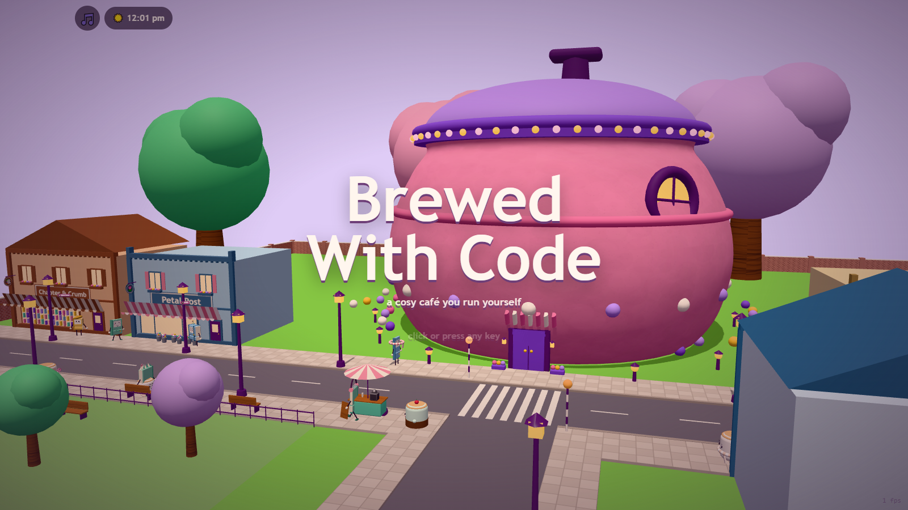
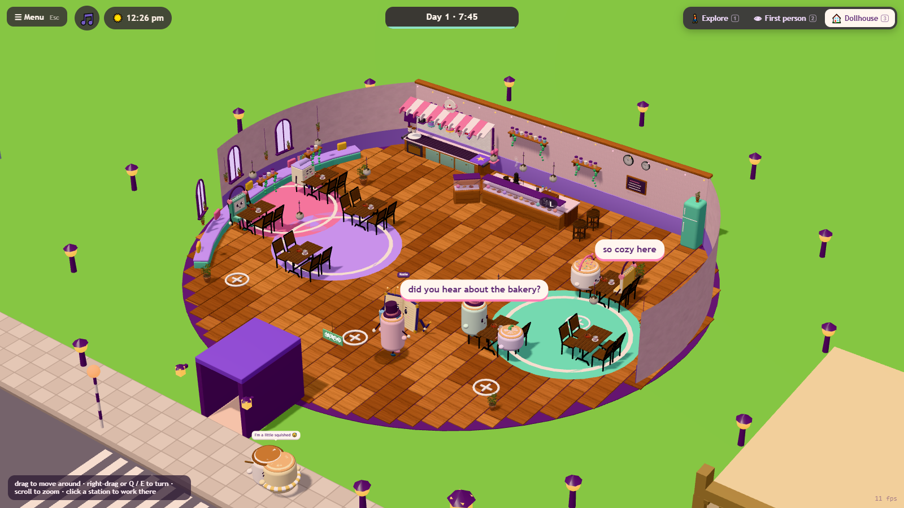
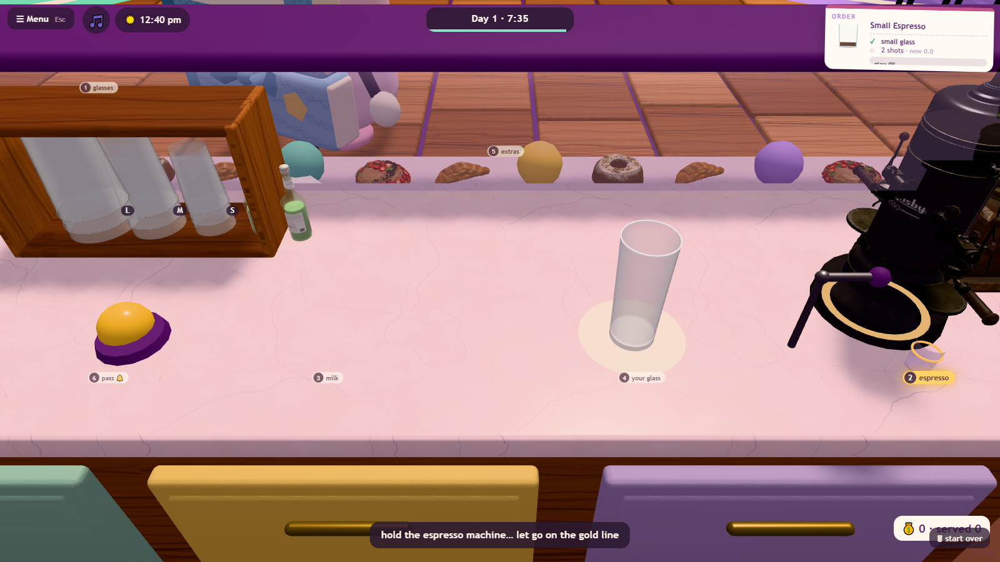
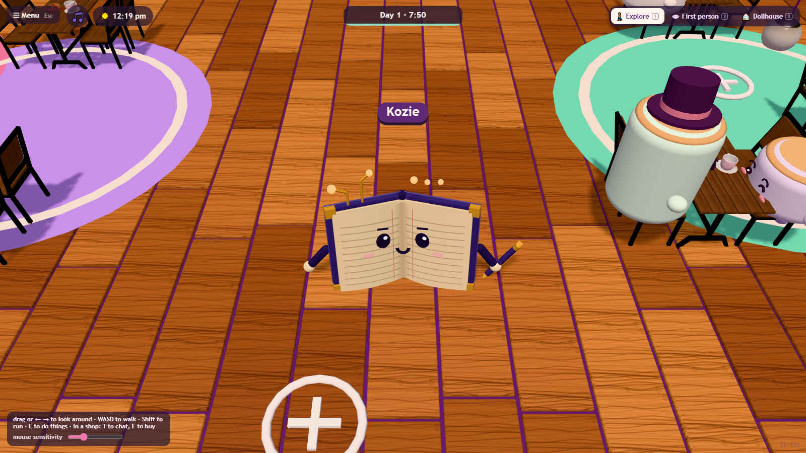
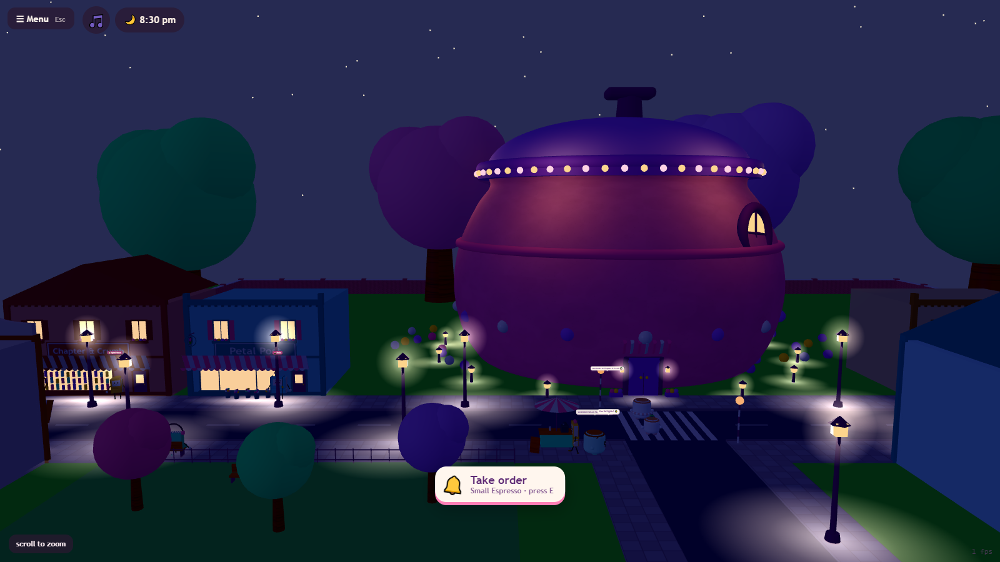
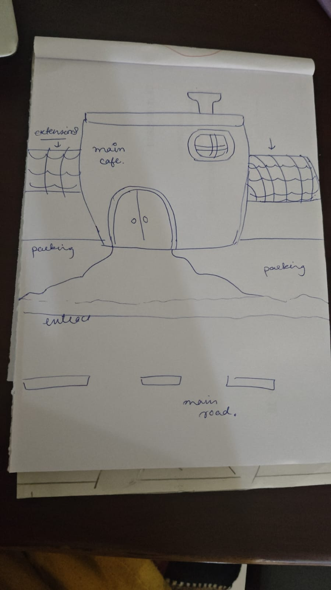
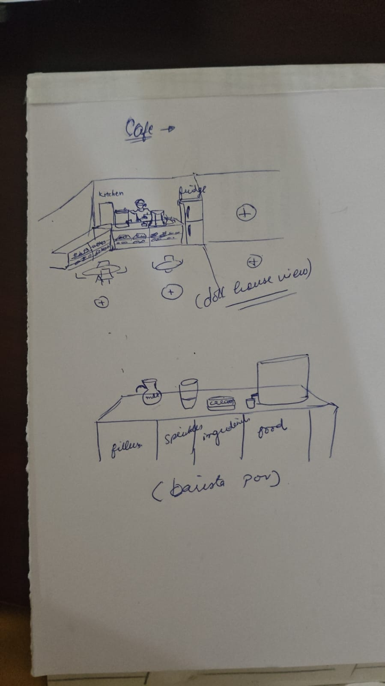

# ☕ Brewed With Code

A cozy, low-poly 3D café game that runs entirely in the browser — built in public as part of **Notes From a B.Tech Brain**.

Run your own coffee-pot-shaped café: take orders, craft real drinks behind the bar, bake layered cakes, serve customers, and explore a candy-coloured street with shops and townsfolk.

<p align="center">
  
</p>

## ✨ Features

- **A café shaped like a coffee pot** — walk around the exterior, peek inside dollhouse-style, or step behind the counter in first-person barista view.
- **Real drink recipes** — espresso, cappuccino, americano, latte, and more. Customise every order: size, shots, milk type, temperature, syrups, foam style, toppings, and latte art.
- **Cake decorating** — stack sponge layers, add fillings, pour frosting that drips down the sides, pipe rosettes, and top with sprinkles, cherries, or candles.
- **Customers & scoring** — customers queue up with orders (sometimes customised). Make the drink, ring the bell, and get scored on accuracy. Perfect orders earn bonus tips.
- **Explore mode** — walk around the street in third person: visit four ingredient shops (The Daily Grind, Moo & Oat, Flour & Co., Sugar Plum), chat with shopkeepers, and watch townsfolk go about their day.
- **Day/night cycle** — the sun moves, stars come out, and the café glows warm at night.
- **Create your character** — name your barista, pick a shape (Kozie, notebook, or marshmallow), and customise colours and face.
- **Multiple camera modes** — Outside, Dollhouse, Walk, and Barista POV with smooth cinematic transitions.

## 📸 Screenshots

<p align="center">
  
</p>
<p align="center"><em>Dollhouse view — peek inside the café from above. Customers chat, sit, and browse.</em></p>

<p align="center">
  
</p>
<p align="center"><em>Behind the bar — pick a glass, pull espresso shots, steam milk, and serve.</em></p>

<p align="center">
  
</p>
<p align="center"><em>Explore mode — walk around as Kozie and discover every corner of the café.</em></p>

<p align="center">
  
</p>
<p align="center"><em>Night falls — the café glows warm under the stars, streetlamps light up the road.</em></p>

## 🎮 How to Play

| Action | Control |
| --- | --- |
| Switch camera | `1` Outside · `2` Dollhouse · `3` Walk · `4` Barista |
| Walk around | `WASD` / arrow keys |
| Look around | drag / `Q` `E` to orbit |
| Zoom | scroll wheel |
| Interact | click stations, drawers, and the serve bell |
| Talk to shopkeepers | `T` to chat · `F` to buy |

## 🛠️ Tech Stack

| | |
| --- | --- |
| **Language** | TypeScript |
| **Framework** | React + React Three Fiber (Three.js) |
| **State** | Zustand |
| **Build** | Vite |
| **3D Assets** | Procedural geometry + CC0 models from [Poly Haven](https://polyhaven.com/) and [Sketchfab](https://sketchfab.com/) |

## 🚀 Getting Started

### Prerequisites

- [Node.js](https://nodejs.org/) (v18+)
- npm

### Install & Run

```bash
# Clone the repo
git clone https://github.com/ZainabShujat/Brewed-With-Code.git
cd Brewed-With-Code

# Install dependencies
npm install

# Download 3D assets (CC0, re-downloadable)
python scripts/fetch_assets.py bar_chair_round_01,coffee_table_round_01,potted_plant_01,potted_plant_02,tea_set_01,metal_jug,croissant,strawberry_chocolate_cake,carrot_cake,modern_ceiling_lamp_01,CashRegister_01,wall_clock

# Start the dev server
npm run dev
```

The game will be running at `http://localhost:5173` (or the port Vite assigns).

### Build for Production

```bash
npm run build
npm run preview
```

## 📁 Project Structure

```
brewed-with-code/
├── src/
│   ├── data/          # Recipes, palette, game constants
│   ├── systems/       # Camera rig, drag & drop, cake logic
│   ├── ui/            # HUD, menus, wind-down screen, styles
│   ├── world/         # 3D scene: bar, exterior, interior, street,
│   │                  #   customers, townsfolk, cake machine, Kozie
│   ├── reel/          # Build-log reel system (code + game split-screen)
│   ├── App.tsx        # Root component
│   └── main.tsx       # Entry point
├── public/
│   └── assets/        # 3D models, textures, music (gitignored — see below)
├── tests/             # Unit tests + automated Playwright play-throughs
├── devlog/            # Build session logs
├── docs/              # Design docs, roadmap, gameplay studies
├── references/
│   └── sketches/      # Original hand-drawn concept sketches
├── scripts/           # Asset download script
└── package.json
```

## 🎨 Design

The art style is **low-poly cute** — rounded shapes, chunky toy-like proportions, and a pink/purple/mauve candy palette inspired by Purble Place. Every layout is based on [hand-drawn concept sketches](references/sketches/), not generated.

<p align="center">
  
  
</p>
<p align="center"><em>Original concept sketches — the coffee-pot café exterior, dollhouse interior, and barista POV</em></p>

## 📓 Dev Log

Each build session is tagged and documented:

| Session | Feature | Tag |
| --- | --- | --- |
| s01 | The coffee-pot café, four camera modes, candy palette | `s01-cafe` |
| s02 | Bigger café, build-up reveal animation, reel system | `s02-bigger-build` |
| s04 | Playable game loop: orders, 3D stations, scoring, coins | `s04-playable` |
| s06 | Cake decorating: layers, frosting, rosettes, sprinkles | `s06-cakes` |

Full session notes are in [`devlog/`](devlog/).

## 🧪 Testing

```bash
npm test
```

Includes unit tests for drink/cake scoring, recipes, and the queue, plus automated Playwright play-throughs that click real 3D stations and verify accuracy.

## 📋 Hardware Target

Designed to run smoothly on **Intel UHD 620** integrated graphics (i7-8565U, 16 GB RAM). If it runs there, it runs everywhere. No bloom, no post-processing — just warm lighting and clean geometry.

## 📄 License

This project's source code is shared for learning. 3D assets from Poly Haven and Sketchfab are used under their respective CC0 / Creative Commons licenses.

## 🔗 Links

- **Part of:** [Notes From a B.Tech Brain](https://github.com/ZainabShujat) — builds, reels, and B.Tech concepts hidden in games
- **Built with:** [React Three Fiber](https://docs.pmnd.rs/react-three-fiber) · [Three.js](https://threejs.org/) · [Zustand](https://zustand-demo.pmnd.rs/) · [Vite](https://vitejs.dev/)

---

*Made with ☕ and code*
